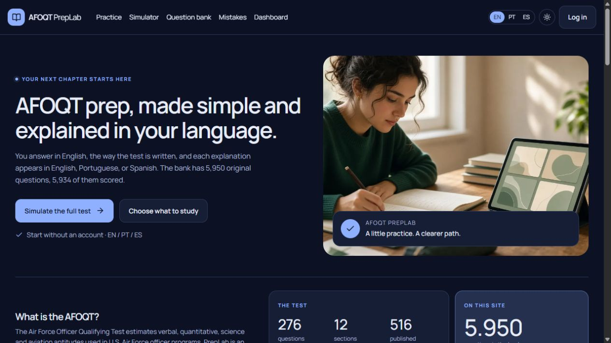
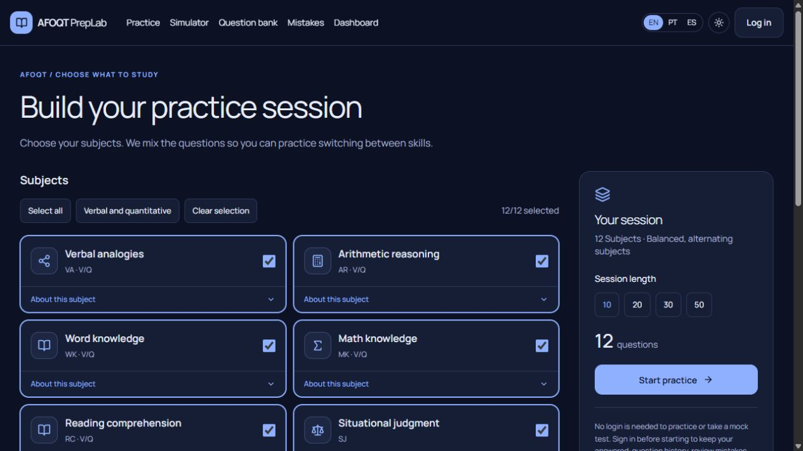
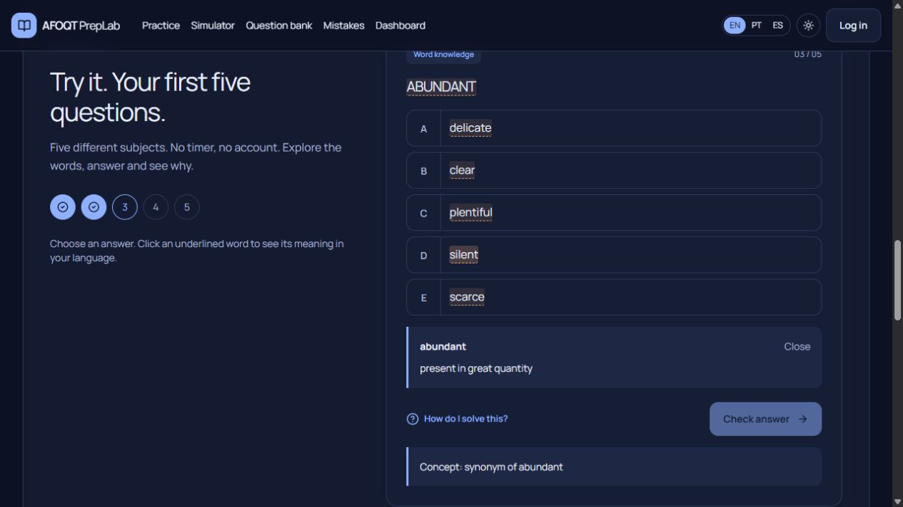

# AFOQT PrepLab

**Practice Smarter. Prepare with Confidence.**

A free, independent study app for people preparing for the Air Force Officer Qualifying Test (AFOQT). Practice by subject, try a timed simulation, explore original questions, and read explanations in English, Portuguese, or Spanish. You can start without an account; sign in to keep your practice history.

[Start locally](#getting-started) · [See the exam format](#the-afoqt)

> AFOQT PrepLab is an independent educational project. It is not affiliated with or endorsed by the U.S. Air Force, the Department of the Air Force, or Pearson VUE.

## The AFOQT

The AFOQT is used for Air Force officer commissioning and selected training programs. It is different from the **ASVAB**, which is used for enlisted applicants. The **AFQT** is a percentile score calculated from four ASVAB subtests; it is not another name for the AFOQT. [U.S. Air Force: AFOQT and academic requirements](https://www.airforce.com/frequently-asked-questions/requirements-eligibility/academic) · [U.S. Air Force: ASVAB and AFQT](https://www.airforce.com/asvab)

Pearson VUE currently describes the official AFOQT as 516 responses across 12 timed subtests, taking about five hours including breaks. The official sections are:

| Subtest | Questions | Time | Main focus |
| --- | ---: | ---: | --- |
| Verbal Analogies | 25 | 8 min | Relationships between words |
| Arithmetic Reasoning | 25 | 29 min | Applied math and word problems |
| Word Knowledge | 25 | 5 min | Word meanings and synonyms |
| Math Knowledge | 25 | 22 min | Algebra, geometry, and arithmetic |
| Reading Comprehension | 25 | 24 min | Meaning and inference in passages |
| Situational Judgment | 16 | 35 min | Interpersonal judgment and leadership |
| Self-Description Inventory | 240 | 45 min | Personality inventory; not scored |
| Physical Science | 20 | 10 min | High-school physical science |
| Table Reading | 40 | 7 min | Fast, accurate table lookup |
| Instrument Comprehension | 25 | 5 min | Interpreting aircraft instruments |
| Block Counting | 30 | 5 min | Spatial awareness |
| Aviation Information | 20 | 8 min | Flight and aviation concepts |

The official test reports percentile composites, not a simple percentage correct. PrepLab's accuracy and progress indicators are for practice only and do not predict or reproduce an official score. See [Pearson VUE's current AFOQT format](https://www.pearsonvue.com/us/en/afoqt.html) and the [Air Force's academic requirements](https://www.airforce.com/frequently-asked-questions/requirements-eligibility/academic).

The Air Force-hosted [AFOQT practice pamphlet](https://www.airforce.com/content/dam/airforce/en/pdf/AFOQT_PracticePamphlet.pdf) reflects an older test form. It is useful for historical familiarization, not as a guide to the current subtest list.

## What PrepLab includes

- Timed full and adaptive simulations, plus a five-section paper-format practice option.
- Practice by subject, with questions alternated across selected topics and quick controls to select all or clear the selection.
- A searchable question bank, vocabulary help, and explanations in English, Portuguese, and Spanish.
- Optional accounts for saved history, missed-question review, favorites, and a progress dashboard.
- **5,950 original practice items:** 5,934 are scoreable in the app, including 8 situational-judgment items assessed with a local training rubric; 16 self-description items are unscored familiarization. No official AFOQT questions are copied.

The app's “full” simulation contains 284 practice items across 12 sections. It is shorter than the official 516-response form: the local bank has 8 situational-judgment items and 16 self-description items, compared with 16 and 240 on the published form. Adaptive practice uses 11 sections and omits the self-description inventory. Paper-format practice covers only Verbal Analogies, Arithmetic Reasoning, Word Knowledge, Math Knowledge, and Reading Comprehension. These are study formats, not official test forms.

## Screenshots

The following screenshots were captured from the running app:



*Home page with the main study options and test overview.*



*Choose all subjects or build a focused practice session.*



*A word-knowledge question with an optional glossary definition and solution hint.*

## Getting started

Requirements: **Node.js 20 or later**, Docker, and Docker Compose. The local PostgreSQL container uses port **5433**; the Next.js app runs at **http://localhost:3010**.

In PowerShell, from the repository directory:

```powershell
Copy-Item .env.example .env
npm install
npm run db:up
npm run db:deploy
npm run db:seed
npm run dev
```

`db:seed` loads the question bank from `banco/export/questions.json`. Keep your local `.env` private and replace its placeholder `AUTH_SECRET` before any deployment.

## Project layout and stack

- `src/app/` — localized pages and API routes; `src/components/` — study and exam interface.
- `src/lib/` — exam logic and shared utilities; `prisma/` — database schema, migrations, and seed script.
- `banco/export/` — source question bank; `content/` and `messages/` — demo material, vocabulary, and translations.
- `public/` — static assets and images.

Built with Next.js 15, React 19, TypeScript, Prisma 6, and PostgreSQL 16.

## Official references

- [Pearson VUE — AFOQT format, sections, timing, and scoring](https://www.pearsonvue.com/us/en/afoqt.html)
- [U.S. Air Force — academic requirements and AFOQT eligibility](https://www.airforce.com/frequently-asked-questions/requirements-eligibility/academic)
- [U.S. Air Force — ASVAB and AFQT](https://www.airforce.com/asvab)
- [Air Force-hosted AFOQT practice pamphlet — historical form](https://www.airforce.com/content/dam/airforce/en/pdf/AFOQT_PracticePamphlet.pdf)
